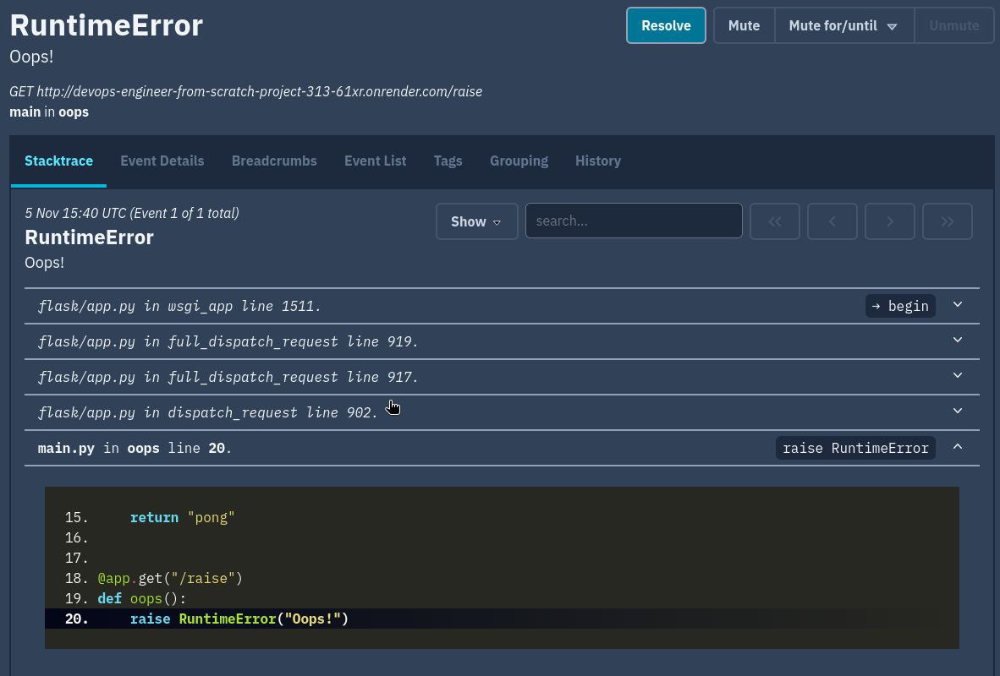

# Деплой приложения на PaaS (Devops)

[](https://github.com/gambit328/devops-engineer-from-scratch-project-313/actions)
[](https://github.com/gambit328/devops-engineer-from-scratch-project-313/actions/workflows/ci.yml)

Создайте и задеплойте веб-приложение, подключите базу данных и настройте мониторинг ошибок

Учебный проект Хекслета: <https://ru.hexlet.io/programs/devops-engineer-from-scratch>

## Стек

- Python

## Установка

<!-- Опишите установку: клонирование, зависимости, переменные окружения -->

```bash
git clone https://github.com/gambit328/devops-engineer-from-scratch-project-313.git
cd devops-engineer-from-scratch-project-313
```

## Использование

```bash
make run
```

<!-- Добавьте примеры запуска и запись asciinema — именно это смотрит работодатель -->

Приложение: <https://devops-engineer-from-scratch-project-313-61xr.onrender.com>



---

<details>
<summary>Автоматические тесты Хекслета</summary>

Тесты запускаются на каждый коммит. За запуск отвечает файл `.github/workflows/hexlet-check.yml` — не удаляйте и не переименовывайте ни его, ни репозиторий.

</details>

## О Хекслете

[Хекслет](https://ru.hexlet.io/) — школа программирования: авторские программы обучения с практикой, поддержкой наставников и реальными проектами, которые остаются в резюме. Этот репозиторий — один из таких проектов.
